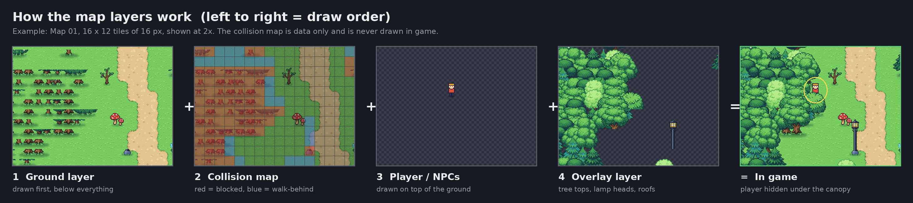
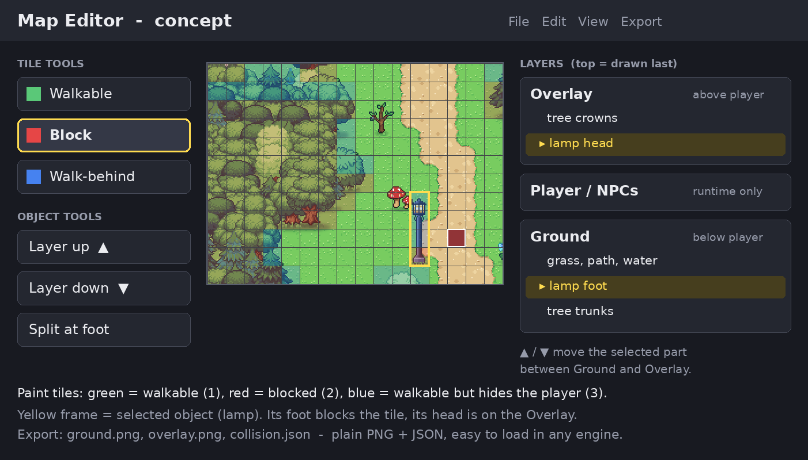

# Application: Map Artist (volunteer) for [Project Name]

Hi [Name / Team],

I've been following [Project Name] for a while, and I really like what you're building. I'd like to help, so I'm offering to make maps for the project. **I'd do this for free.** I'm not asking for money or credit beyond what you'd normally give contributors. I just want the project to look and play as good as it can.

## What I can contribute

I've already built five complete, animated top-down maps in a 16×16 px tile style:

| Map | Size (tiles) | Theme |
|---|---|---|
| Map 01 | 110 × 120 | Forest, river, waterfall, cliffs, beach |
| Map 02 – Factorial Town | 95 × 75 | Industrial town, reactor, workshop |
| Map 03 – Server Desert | 112 × 80 | Dunes, buried arena, satellite dishes |
| Map 04 – Gear Savanna | 110 × 85 | Savanna, canyon, tar pit, plateaus |
| Map 05 – Freezeland | 110 × 85 | Ice cliffs, frozen lake, crevasses, snowfall |

Every map comes with:

- **Animation**: flowing water, waves, grass and trees moving in the wind, campfires, lanterns, snowfall. I also export water tiles as frame strips so an engine can animate them itself.
- **Clean grid alignment**: every object is centered on a 16×16 tile, so collision lines up exactly with what you see.
- **Game-ready layers**: ground, collision and overlay come as separate files (see below).
- **Reproducible builds**: everything is generated by scripts, so changes are quick and I don't have to redraw by hand.

I can adapt to your style, tile size and engine, and I'm happy to take feedback and do revisions.

## How the layer system works

Read the picture from left to right. That's also the order the game draws things in:

1. **Ground layer** (`ground.png`): everything *below* the player. Grass, paths, water, cliffs, bridges, ground shadows, and the **foot** of tall objects (tree trunks, lamp posts, rock bases).
2. **Collision map** (`collision.json`): never drawn, data only. One value per tile:
   - `1` = walkable
   - `2` = blocked (water, cliffs, the foot of a tree or lamp)
   - `3` = walkable, but the player is hidden behind something (e.g. under a tree crown)
3. **Player / NPCs**: the game draws them on top of the ground.
4. **Overlay layer** (`overlay.png`, transparent): everything *above* the player. Tree crowns, lamp heads, roofs, the upper parts of rocks and bushes.

**Result:** the player can walk behind a tree, and the crown covers them correctly (yellow circle in the last picture), while the trunk still blocks the way.

The trick is that **tall objects are split at the foot**. The bottom ~10 px (trunk, post, base) go on the ground layer and block their tile. Everything above goes on the overlay. Because objects sit exactly on the tile grid, this works the same way for every object.

Draw order in the game: `ground` → `player / NPCs` → `overlay`. That's all the engine needs.

## Idea: a simple map editor

To make maps easier to fix and extend, including for other people on the team, I'd like to build a small editor on top of this system:

- **Tile tools: blocking**
  You paint collision straight onto the map. Green = walkable, red = **blocked**, blue = walk-behind. If a tile is wrong (you get stuck somewhere, or can walk through a rock), you fix it with one click. No need to edit files by hand.

- **Object tools: layer up / layer down**
  Click an object (in the picture, the lamp in the yellow frame) and move it, or one part of it, **up** to the overlay (drawn over the player) or **down** to the ground (drawn under the player). The layer panel on the right always shows where each part is. Example: lamp head → overlay, lamp foot → ground.

- **Split at foot**
  Splits a tall object into a foot (ground and blocked) and a top (overlay) automatically, the same way all my current maps are built.

- **Export**
  `ground.png`, `overlay.png`, `collision.json`: plain PNG + JSON files that any engine can load easily.

That way the team can make small changes themselves without waiting for me.

## About me

[A short paragraph: your name/nickname, how you found the project, what you like about it, your experience with pixel art and maps, and how much time you can put in per week.]

I'd love to show you more of the maps (full resolution, animated GIFs, individual layers) or build a test map in your style first so you can see if it's a good fit.

Thanks for reading, and thanks for the work you're putting into [Project Name]!

Best regards,
[Your name]
[Discord / email]
